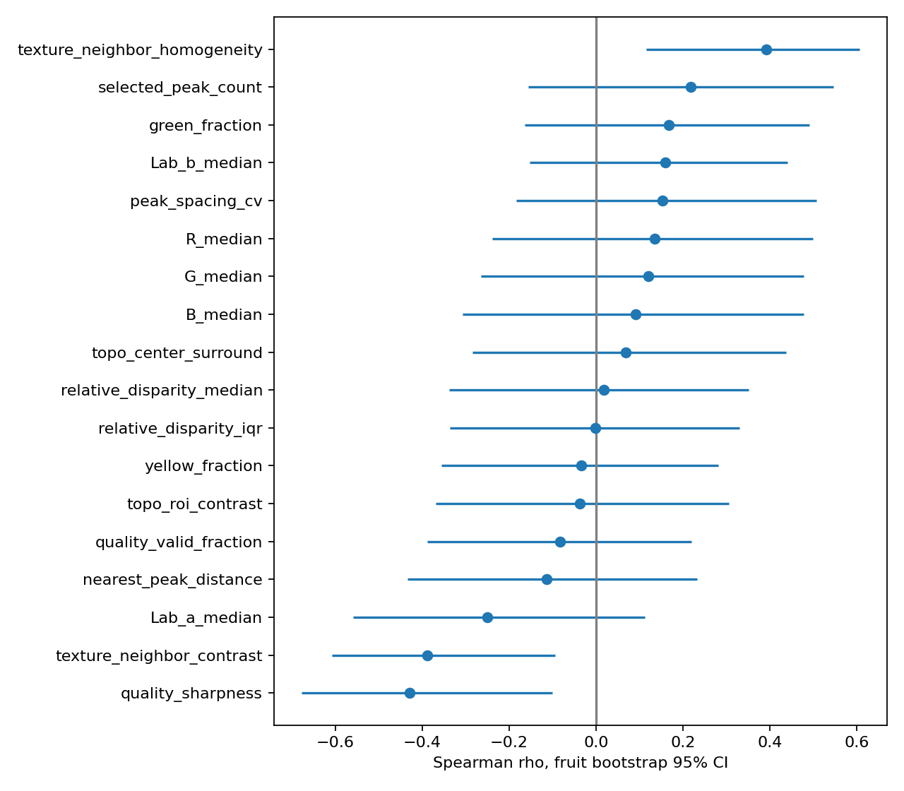
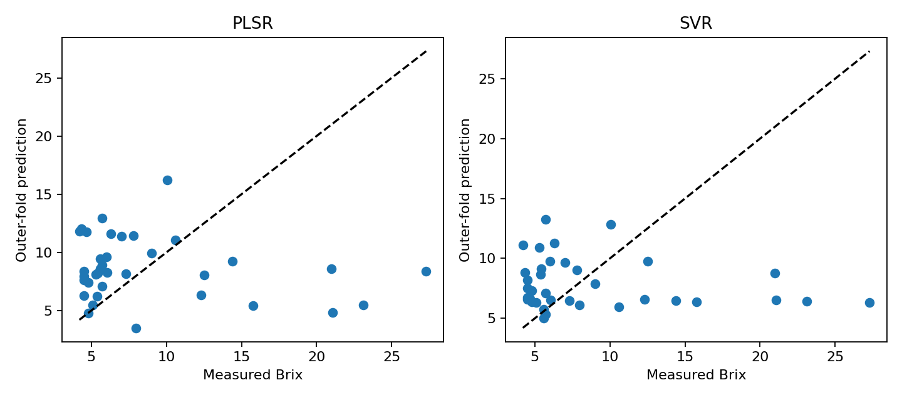

# Durian Quality Analysis with Stereo Vision

Nghiên cứu màu vỏ, kết cấu và hình học gai từ ảnh stereo để khảo sát mối liên hệ với Brix của sầu riêng. Repository cũng giữ kiến trúc phân loại xanh/chín ResNet18 + CNN ROI + Attention-MIL như một hướng thử nghiệm riêng.

## Phương pháp

Ảnh stereo → hiệu chuẩn → StereoSGBM + WLS → disparity/topography → ROI gai → đặc trưng cấp quả → Spearman, bootstrap, PLSR/SVR và permutation test.

- 36 quả có nhãn, 578 cặp stereo; nhiều góc của một quả được tổng hợp thành một mẫu.
- 16 đặc trưng dự đoán, 2 chỉ số chất lượng phục vụ kiểm tra nhiễu.
- Bootstrap 2.000 lần, BH cho 18 kiểm định tương quan.
- Nested CV: 3 fold ngoài, 3 fold trong, lặp seed 42/7/77.
- 199 lần hoán vị nhãn, chạy lại chọn tham số cho seed 42.

## Kết quả chính

| Mô hình | MAE (°Brix) | RMSE (°Brix) | R² |
|---|---:|---:|---:|
| Trung bình train | 4,717 | 6,206 | −0,114 |
| PLSR | 5,092 | 6,923 | −0,384 |
| SVR | 4,418 | 6,470 | −0,209 |

Chưa có đặc trưng đạt q<0,05 sau hiệu chỉnh. Permutation p của PLSR là 0,575; SVR là 0,780. Dữ liệu và đặc trưng hiện tại chưa chứng minh khả năng dự đoán Brix ổn định. Đây không phải bằng chứng mọi đặc trưng bên ngoài đều không liên quan tới Brix.




## Mã nguồn

| Tệp | Vai trò |
|---|---|
| src/calibrate_stereo.py | Hiệu chuẩn cặp camera bằng bàn cờ |
| src/preprocess_stereo.py | Rectification, disparity, topography và ROI |
| src/study_brix_association.py | Phân tích thống kê và hồi quy cấp quả |
| src/train_attention_mil.py | Phân loại xanh/chín với ResNet18 + CNN ROI + Attention-MIL |
| src/predict_attention_ensemble.py | Suy luận ensemble phân loại, cần checkpoint tương thích |

## Cài đặt và chạy

Python với các thư viện trong requirements.txt. Cài PyTorch/torchvision phù hợp máy CPU hoặc CUDA; không bắt buộc GPU cho phân tích PLSR/SVR. Các phiên bản thư viện chưa được khóa; đây là bản xuất mã nghiên cứu, chưa được thử end-to-end trên máy sạch.

```bash
pip install -r requirements.txt
python src/study_brix_association.py
```

Theo mặc định, dữ liệu riêng đặt trong `data/` (không được commit). Có thể đặt biến môi trường `DURIAN_DATA_ROOT` trỏ đến thư mục dự án dữ liệu hiện có. Ví dụ PowerShell:

```powershell
$env:DURIAN_DATA_ROOT = 'D:\durian_private_data'
python src/study_brix_association.py
```

Phân tích cần:

- `processed/*.npz`: global4 (224×224×4 uint8), roi_large (K×32×32×4), roi_meta (K×5: x,y chuẩn hóa, khoảng cách tâm, confidence, tỷ lệ hợp lệ), mask_valid và fruit_id.
- `labels_brix_clean.json`: `{"fruit_summary":[{"fruit_id":"example","values":[10.2,10.4]}]}`. Dùng trung vị các giá trị làm nhãn.

Tiền xử lý cần `stereo_manifest.json` (danh sách fruit_id, position, left, right), `dataset_audit.json` (fruit_summary với fruit_id, class_label ripe/unripe, brix_mean) và `calibration/stereo_calibration.npz` chứa map1x/map1y/map2x/map2y. Đường dẫn left/right trong manifest phải trỏ đến ảnh trên máy đang chạy. Chạy `python src/preprocess_stereo.py` để tạo processed.

Hiệu chuẩn: đặt `DURIAN_CALIB_IMAGES` đến thư mục bàn cờ chứa cặp `*_camA_*.png` và `*_camB_*.png` với chỉ số `_p..._`. Mã mặc định dùng bàn cờ 8×6 góc trong, SQUARE=1.0 (đơn vị ô bàn cờ), không mặc định là mm. Chỉnh các thông số này đúng thiết bị trước khi chạy `python src/calibrate_stereo.py`.

Phân loại: `python src/train_attention_mil.py --mode attention --backbone resnet18 --folds 3`. Cần thêm roi_small, class_id, position trong NPZ. Script train ghi `runs/fold1_resnet18_attention.pt` đến `fold3_resnet18_attention.pt`; script predict đã được đồng bộ tên checkpoint và dùng ngưỡng mặc định 0,5. Chạy `python src/predict_attention_ensemble.py data/processed/example.npz` sau khi huấn luyện. Nhánh này giữ để tham khảo và không tạo ra các chỉ số Brix trong bảng trên; cần đánh giá trên quả độc lập trước khi sử dụng.

## Giới hạn

- Kênh global thứ tư là disparity chuẩn hóa, không phải depth vật lý. Topography là residual disparity đã cắt và chuẩn hóa, không phải chiều cao gai theo mm.
- Đỉnh được chọn bằng NMS và giới hạn 32; số ROI không phải tổng số gai thật.
- Nhãn nghiên cứu kế thừa quy trình chuyển số/ngày trong Excel chưa xác minh độc lập. Cần kiểm tra nhãn trước khi diễn giải sinh học.
- Mask được ước lượng tự động; độ nét/ánh sáng có thể gây nhiễu. Giả định độc lập theo quả chưa kiểm chứng ở cấp cây/vườn.
- Phân loại xanh/chín khác hồi quy Brix; không dùng chung chỉ số của hai nhiệm vụ. Attention không phải chứng minh quan hệ nhân quả.
- Dataset, bảng nhãn cá thể và checkpoint không được phân phối trong repository. Người dùng phải cung cấp dữ liệu có quyền sử dụng. Không thể chạy huấn luyện chỉ bằng các tệp công khai này.

Mã xuất đã kiểm tra cú pháp; số liệu và hình là kết quả của lần chạy trước trên dữ liệu riêng, không phải kết quả chạy lại sau khi đóng gói.
